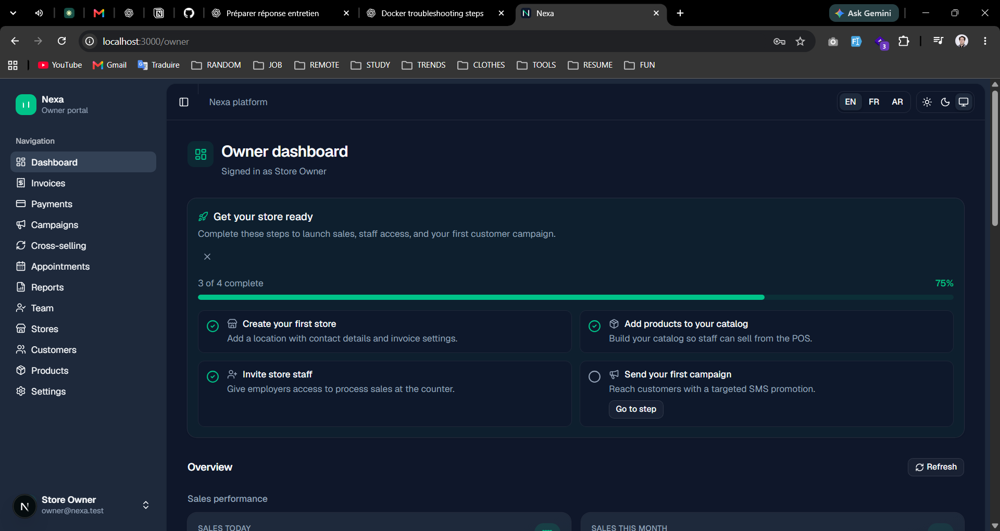
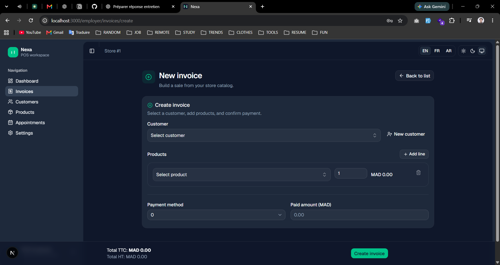
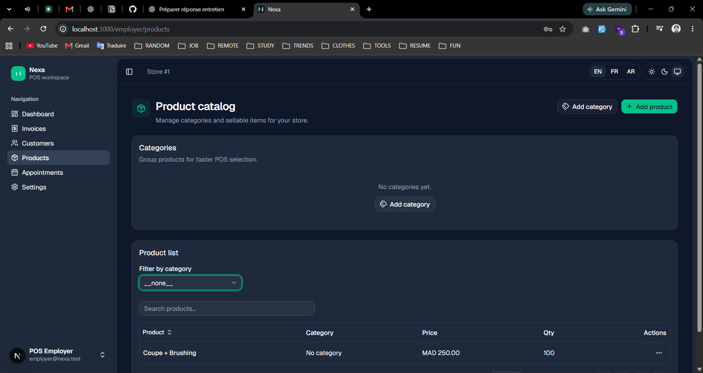

# Nexa Platform

[](https://github.com/WalidChaabi/nexa-platform/actions/workflows/v2-ci.yml)
[](LICENSE)
[](https://laravel.com/)
[](https://nextjs.org/)

Multi-store retail and POS platform — campaigns, payments, reporting, and team management for business owners and store staff.

**V2 is the current application**, built in `apps/nexa-api` and `apps/nexa-web`. The Laravel 5.7 monolith in `legacy/v1/` is retained for reference only.

## Screenshots

Local captures of the V2 interface; these illustrate screens, not verified functionality, test results, or production readiness.



Owner dashboard with store setup tasks and the sales overview below.



POS invoice form for selecting a customer, adding product lines, and entering payment details.



Product catalog with category filtering, search, prices, and quantities.

**Author:** [Walid Chaabi](https://github.com/WalidChaabi)

---

## Highlights

- **API-first architecture** — Laravel 12 REST API + Next.js 16 web app (Sanctum auth, policies, form requests)
- **Role-based workspaces** — Platform admin, business owner, and store employer portals
- **Core retail flows** — POS invoices, product catalog, customers, campaigns, cross-selling, calendar
- **Quality gates** — PHPUnit feature tests, Playwright E2E, Laravel Pint, ESLint, Docker dev stack
- **Trilingual UI** — English, French, and Arabic (RTL)

---

## Architecture

| Track | Path | Stack | Status |
|-------|------|-------|--------|
| **V2** (current) | `apps/nexa-api`, `apps/nexa-web` | Laravel 12 + Next.js 16 | Active development |
| **V1** (legacy) | `legacy/v1` | Laravel 5.7 monolith | Reference only |

```
nexa-platform/
├── apps/
│   ├── nexa-api/          # Laravel 12 REST API
│   └── nexa-web/          # Next.js 16 web app
├── legacy/v1/             # Legacy reference (not actively developed)
├── docs/                  # Audits, ADRs, runbooks, GA plan
├── infra/                 # Docker Compose
└── docker-compose.yml
```

---

## Quick start (V2)

**Prerequisites:** Docker, or PHP 8.2+, Composer 2, Node.js 20+, and MySQL 8.

```bash
git clone https://github.com/WalidChaabi/nexa-platform.git
cd nexa-platform
docker compose up -d
```

| Service | URL |
|---------|-----|
| Web UI | http://localhost:3000 |
| API health | http://localhost:8000/api/v1/health |
| MySQL | `localhost:3306` — database `nexa_test`, user `me` / password `ok` |

Full setup without Docker: [docs/v2-local-setup.md](docs/v2-local-setup.md).

---

## Tech stack

| Layer | Technologies |
|-------|----------------|
| API | Laravel 12, PHP 8.2+, Sanctum, Policies, MySQL |
| Web | Next.js 16, React 19, Tailwind 4, shadcn/ui, TanStack Table, Recharts |
| Testing | PHPUnit, Playwright |
| Ops | Docker Compose, GitHub Actions |

---

## Documentation

| Topic | Location |
|-------|----------|
| V2 local development | [docs/v2-local-setup.md](docs/v2-local-setup.md) |
| Product audit & roadmap | [docs/nexa-product-audit-and-roadmap.md](docs/nexa-product-audit-and-roadmap.md) |
| v1.0 GA implementation plan | [docs/improvement/nexa-v1-ga-implementation-plan.md](docs/improvement/nexa-v1-ga-implementation-plan.md) |
| V1 vs V2 comparison | [docs/technical-audit-v1-v2.md](docs/technical-audit-v1-v2.md) |
| ADR: API-first UI | [docs/adr/002-nextjs-api-first-ui.md](docs/adr/002-nextjs-api-first-ui.md) |

Per-app READMEs: [nexa-api](apps/nexa-api/README.md) · [nexa-web](apps/nexa-web/README.md)

---

## Development

```bash
# API tests + style
cd apps/nexa-api && composer test && vendor/bin/pint --test

# Web lint + build
cd apps/nexa-web && npm run lint && npm run build

# E2E (API + web must be running)
cd apps/nexa-web && npm run test:e2e
```

CI workflow: [.github/workflows/v2-ci.yml](.github/workflows/v2-ci.yml)

---

## Status

V2 is under active development. See the [GA implementation plan](docs/improvement/nexa-v1-ga-implementation-plan.md) for the release checklist; the v1.0 release label is separate from the legacy V1 application.

---

## License

MIT — see [LICENSE](LICENSE).
