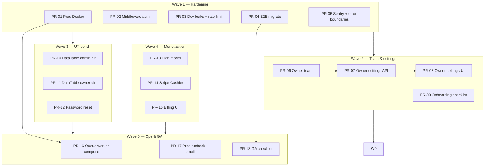

# Nexa v1.0 GA — Implementation Plan (PR-driven)

**Source:** [nexa-product-audit-and-roadmap.md](../nexa-product-audit-and-roadmap.md)  
**Base branch:** `v2/main`  
**Workflow:** [git-pr-and-release-workflow.md](./git-pr-and-release-workflow.md)  
**Horizon:** ~8–12 weeks · **one logical change per PR** · target **&lt; 400 lines** per PR

This plan turns the product audit into **reviewable pull requests**. Each PR has a branch name, scope, dependencies, and acceptance criteria. Merge in **stack order** unless noted as parallel-safe.

---

## How we ship (PR discipline)

| Rule | Detail |
|------|--------|
| Branch from | `v2/main` only |
| Naming | `v2/<type>/<short-topic>` — e.g. `v2/feat/owner-team` |
| PR title | Conventional Commits — same as merge commit if squash |
| Size | Prefer **S (50–200 lines)**; split at 400 lines |
| Review | 1 reviewer; CI green (`v2-ci.yml`: Pint, PHPUnit, Playwright) |
| Merge | Squash to `v2/main` (keeps history readable) |
| Docs-only | Separate `docs(...)` PRs from code when possible |

**Stacked PRs:** If PR-B needs PR-A, open PR-A first, then branch PR-B from PR-A and set base to `v2/feat/...` until A merges; rebase B onto `v2/main` after.

---

## Progress snapshot (June 2026)

| Item | Status | Notes |
|------|--------|-------|
| Marketing home | ✅ Merged | `feat(web): marketing landing page` |
| Marketing stubs (pricing, legal, docs hub) | 🟡 Local / unmerged | Pages under `app/pricing`, `privacy`, `terms`, etc. |
| Owner invite employers | 🟡 PRs open | [#35](https://github.com/AIWebCoder/nexa-platform/pull/35) API + [#36](https://github.com/AIWebCoder/nexa-platform/pull/36) UI |
| Audit & roadmap docs | ✅ Merged | |
| v1.0 GA blockers | 🔴 Most open | See waves below |

---

## Dependency graph (waves)



---

## Wave 1 — Production hardening (weeks 1–2)

**Goal:** Safe to deploy on a real domain without dev artifacts or silent regressions.

### PR-01 — Production Docker images

| Field | Value |
|-------|-------|
| **Branch** | `v2/chore/prod-docker` |
| **Title** | `chore(docker): add production API and web images` |
| **Scope** | BE + FE + Ops |
| **Depends on** | — |
| **Parallel** | Yes (with PR-03, PR-04) |

**Tasks:**
- `apps/nexa-web/Dockerfile` — multi-stage: `npm ci` → `next build` → `next start`
- `apps/nexa-api/Dockerfile` — production target (php-fpm or `artisan serve` + opcache)
- `docker-compose.prod.yml` (optional) — web + api + mysql + redis, no bind-mount dev hacks
- Document in `docs/runbooks/deployment-v2.md`

**Acceptance:**
- [ ] `docker build` web image runs `next start` on port 3000
- [ ] API image runs migrations + serves `/api/v1/health`
- [ ] No `dev:docker` in production compose

**Est. size:** M (~150 lines)

---

### PR-02 — Next.js middleware auth gate

| Field | Value |
|-------|-------|
| **Branch** | `v2/feat/middleware-auth` |
| **Title** | `feat(web): protect dashboard routes with middleware` |
| **Scope** | FE |
| **Depends on** | — |

**Tasks:**
- Add `apps/nexa-web/middleware.ts`
- Cookie/session check via internal API or edge-safe pattern
- Redirect unauthenticated users from `(admin|owner|employer)/*` → `/login`
- Redirect wrong role to correct `dashboard_path`

**Acceptance:**
- [ ] Direct hit `/owner/invoices` without session → `/login` (no flash of dashboard)
- [ ] Employer cannot open `/admin` routes

**Est. size:** M (~120 lines)

---

### PR-03 — Remove dev defaults + API rate limiting

| Field | Value |
|-------|-------|
| **Branch** | `v2/fix/prod-hardening` |
| **Title** | `fix(api): remove dev login defaults and add API rate limits` |
| **Scope** | FE + BE |
| **Depends on** | — |

**Tasks:**
- Remove pre-filled credentials from `login-form.tsx`; gate dev hint behind `NODE_ENV === 'development'`
- Laravel: `throttle:api` or custom `60,1` on authenticated route group
- CI grep/script: fail if `nexa.test` password appears in non-test sources

**Acceptance:**
- [ ] Production build login form is empty
- [ ] Authenticated API returns 429 after burst limit in test

**Est. size:** S (~80 lines)

---

### PR-04 — Migrate Playwright E2E to nexa-web

| Field | Value |
|-------|-------|
| **Branch** | `v2/test/e2e-nexa-web` |
| **Title** | `test(e2e): move Playwright specs to apps/nexa-web` |
| **Scope** | FE + CI |
| **Depends on** | — |

**Tasks:**
- Move `apps/sherin-web/e2e/*.spec.ts` → `apps/nexa-web/e2e/`
- Add `playwright.config.ts` with `PLAYWRIGHT_BASE_URL`
- Verify `.github/workflows/v2-ci.yml` `npm run test:e2e` runs ≥3 specs
- Minimum specs: login, employer invoice create, owner checkout (if exists)

**Acceptance:**
- [ ] `npm run test:e2e` passes locally against docker stack
- [ ] CI E2E job non-empty and green

**Est. size:** M (~200 lines)

---

### PR-05 — Sentry + App Router error boundaries

| Field | Value |
|-------|-------|
| **Branch** | `v2/chore/observability` |
| **Title** | `chore(obs): add Sentry and error/loading routes` |
| **Scope** | FE + BE |
| **Depends on** | PR-01 (env vars documented) |

**Tasks:**
- Sentry SDK API + web (DSN via env, no secrets in repo)
- `app/(admin)/admin/error.tsx`, `loading.tsx` — replicate for owner/employer groups
- Optional: `global-error.tsx`

**Acceptance:**
- [ ] Thrown error in dev surfaces error boundary
- [ ] Sentry receives test event when DSN set

**Est. size:** M (~180 lines)

---

## Wave 2 — Team & onboarding (weeks 3–4)

**Goal:** Owners scale without platform admin for every hire.

### PR-06 — Owner invite employers (API + UI) ✅ ready to open

| Field | Value |
|-------|-------|
| **Branch** | `v2/feat/owner-team` |
| **Title** | `feat(team): owner invite and manage store employers` |
| **Scope** | BE + FE |
| **Depends on** | — |
| **Status** | **Open — [#35](https://github.com/AIWebCoder/nexa-platform/pull/35) + [#36](https://github.com/AIWebCoder/nexa-platform/pull/36)** |

**Includes:**
- `EmployerController`, requests, `EmployerResource`, routes `/api/v1/employers`
- `User::store()` relationship
- `tests/Feature/Employers/EmployerApiTest.php` (8 tests)
- Web: `/owner/team`, `lib/api/employers.ts`, employer components, nav + i18n

**Split option (if reviewer prefers smaller PRs):**
- PR-06a `v2/feat/employers-api` — API only
- PR-06b `v2/feat/owner-team-ui` — depends on 06a

**Acceptance:**
- [ ] Owner invites employer to owned store; employer logs in and sees POS
- [ ] Owner cannot manage employer on foreign store (403)
- [ ] Employer cannot call `/employers` (403)
- [ ] PHPUnit `EmployerApiTest` green

**Est. size:** L (~600 lines) — **recommend split 06a/06b** if strict 400-line rule

---

### PR-07 — Owner & employer profile API

| Field | Value |
|-------|-------|
| **Branch** | `v2/feat/profile-api` |
| **Title** | `feat(auth): profile read/update and password change API` |
| **Scope** | BE |
| **Depends on** | PR-06 |

**Tasks:**
- `GET/PUT /api/v1/auth/profile` — firstname, lastname, phone
- `PUT /api/v1/auth/password` — current + new password
- Form requests + tests (owner, employer; not cross-user)

**Acceptance:**
- [ ] User updates own profile; cannot change `is_admin` or `store_id` via mass assignment
- [ ] Password change invalidates other sessions (optional v1.0)

**Est. size:** M (~200 lines)

---

### PR-08 — Owner & employer settings UI

| Field | Value |
|-------|-------|
| **Branch** | `v2/feat/settings-ui` |
| **Title** | `feat(web): owner and employer settings pages` |
| **Scope** | FE |
| **Depends on** | PR-07 |

**Tasks:**
- `/owner/settings`, `/employer/settings` — profile form, password change
- Enable sidebar profile link (`sidebar-user-footer.tsx`)
- Reuse locale/theme from admin settings pattern
- Store display preferences (currency label, timezone) — read from user/store, save where appropriate

**Acceptance:**
- [ ] Owner changes password and logs in with new password
- [ ] Settings linked from nav or sidebar

**Est. size:** M (~250 lines)

---

### PR-09 — Owner onboarding checklist

| Field | Value |
|-------|-------|
| **Branch** | `v2/feat/onboarding-checklist` |
| **Title** | `feat(web): owner dashboard onboarding checklist` |
| **Scope** | FE (+ optional lightweight API) |
| **Depends on** | PR-06, PR-08 |

**Tasks:**
- Dashboard card on `/owner`: steps with completion state
  1. Create store
  2. Add products
  3. Invite team member
  4. Create first campaign
- Derive completion from existing APIs (stores count, products count, employers count, campaign-details count)
- i18n en/fr/ar

**Acceptance:**
- [ ] Fresh owner sees checklist; steps check off as completed
- [ ] Links navigate to correct pages

**Est. size:** M (~200 lines)

---

## Wave 3 — UX polish (weeks 5–6)

**Goal:** Product feels finished; list pages consistent.

### PR-10 — DataTable migration (admin directory pages)

| Field | Value |
|-------|-------|
| **Branch** | `v2/feat/ui-admin-directory` |
| **Title** | `feat(web): DataTable pattern on admin directory pages` |
| **Scope** | FE |
| **Depends on** | — (parallel with Wave 2) |

**Pages (one PR or split per page):**
- `admin/stores` — read-only + row view link
- `admin/customers`, `admin/products` — read-only
- `admin/payments`, `admin/campaigns`, `admin/cross-selling`

**Pattern:** `.cursor/rules/nexa-web-ui.mdc` — columns file + `DataTableRowActionsMenu`

**Acceptance:**
- [ ] No inline `DropdownMenu` inside `*-columns.tsx`
- [ ] `filterPlaceholder` + i18n on each page

**Est. size:** L — **split recommended:**
- PR-10a `v2/feat/ui-admin-stores`
- PR-10b `v2/feat/ui-admin-customers-products`
- PR-10c `v2/feat/ui-admin-payments-campaigns`

---

### PR-11 — DataTable migration (owner directory pages)

| Field | Value |
|-------|-------|
| **Branch** | `v2/feat/ui-owner-directory` |
| **Title** | `feat(web): DataTable pattern on owner list pages` |
| **Scope** | FE |
| **Depends on** | — |

**Pages:**
- `owner/customers`, `owner/products` — add Dialog CRUD (reuse employer components where possible)
- `owner/invoices` — DataTable + view/print actions
- `owner/payments` — list + link to checkout

**Acceptance:**
- [ ] Owner can CRUD customers/products from owner portal (parity with employer)

**Est. size:** L — split per domain (customers/products, invoices, payments)

---

### PR-12 — Password reset flow

| Field | Value |
|-------|-------|
| **Branch** | `v2/feat/password-reset` |
| **Title** | `feat(auth): password reset request and confirm flow` |
| **Scope** | BE + FE |
| **Depends on** | PR-17 (email provider) or use `log` driver in dev only |

**Tasks:**
- Laravel password reset tokens + notification
- `/forgot-password`, `/reset-password` pages
- Rate limit reset requests

**Acceptance:**
- [ ] User receives reset link (mailhog/staging SMTP)
- [ ] Token expires; invalid token shows error

**Est. size:** M (~300 lines)

---

## Wave 4 — Monetization (weeks 7–8)

**Goal:** You can charge for Nexa, not only pass-through SMS via CMI.

Pick **one path** for v1.0 GA:

| Path | PRs | Best when |
|------|-----|-----------|
| **A — Sales-led** | PR-13 only | Need GA fast; invoice customers manually |
| **B — Stripe** | PR-13 + PR-14 + PR-15 | Want credible SaaS story |

### PR-13 — Plan entitlements (data model)

| Field | Value |
|-------|-------|
| **Branch** | `v2/feat/plan-entitlements` |
| **Title** | `feat(billing): add owner plan field and entitlement checks` |
| **Scope** | BE |
| **Depends on** | — |

**Tasks:**
- Migration: `owners.plan` enum (`starter`, `growth`, `enterprise`, `trial`) or `subscriptions` table stub
- Admin: set plan on owner create/edit
- Middleware or service: gate features (e.g. campaigns on starter) — start with read-only flags

**Acceptance:**
- [ ] Admin assigns plan; API returns plan on `/auth/me` for owners
- [ ] Feature test: starter cannot create campaign (if gating enabled)

**Est. size:** M (~200 lines)

---

### PR-14 — Stripe subscription (Laravel Cashier)

| Field | Value |
|-------|-------|
| **Branch** | `v2/feat/stripe-cashier` |
| **Title** | `feat(billing): Stripe subscriptions for owner accounts` |
| **Scope** | BE |
| **Depends on** | PR-13 |

**Tasks:**
- `laravel/cashier` — owner as Stripe customer
- Checkout session or billing portal URL endpoints
- Webhook handler for `subscription.updated`
- Sandbox keys in `.env.example` only

**Acceptance:**
- [ ] Owner completes Stripe test checkout
- [ ] Webhook activates plan on owner record

**Est. size:** L (~350 lines)

---

### PR-15 — Billing UI + pricing page wiring

| Field | Value |
|-------|-------|
| **Branch** | `v2/feat/billing-ui` |
| **Title** | `feat(web): owner billing page and live pricing CTAs` |
| **Scope** | FE |
| **Depends on** | PR-14 (or PR-13 for sales-led) |

**Tasks:**
- `/owner/billing` or extend `/owner/payments` — subscription status + portal link
- Wire `/pricing` CTAs → login or Stripe checkout (not only `#`)
- Show current plan in owner dashboard KPI area

**Acceptance:**
- [ ] Pricing page CTA leads to checkout or contact flow
- [ ] Owner sees active plan and next billing date (Stripe test mode)

**Est. size:** M (~200 lines)

---

## Wave 5 — Ops & GA (weeks 9–12)

### PR-16 — Queue worker in Docker Compose

| Field | Value |
|-------|-------|
| **Branch** | `v2/chore/queue-worker-compose` |
| **Title** | `chore(docker): add Redis and queue worker service` |
| **Scope** | Ops |
| **Depends on** | PR-01 |

**Tasks:**
- `docker-compose.yml`: `redis` + `api-queue` service running `queue:work`
- Dev docs: SMS jobs process without manual artisan

**Acceptance:**
- [ ] `SendCampaignSmsJob` processes after `nexa:cross-selling` in local docker

**Est. size:** S (~60 lines)

---

### PR-17 — Production runbook + transactional email

| Field | Value |
|-------|-------|
| **Branch** | `v2/docs/prod-runbook-email` |
| **Title** | `docs(ops): production runbook and Resend/Postmark mail config` |
| **Scope** | Ops + BE |
| **Depends on** | PR-01 |

**Tasks:**
- Extend `deployment-v2.md`: Sanctum, CORS, backups, cron, Redis, env matrix
- Configure `MAIL_MAILER` for staging (Resend/Postmark)
- Payment confirmation email works in staging

**Acceptance:**
- [ ] New engineer deploys from runbook alone
- [ ] Test email delivered in staging

**Est. size:** S (~100 lines docs + small config)

---

### PR-18 — GA sign-off checklist + marketing polish

| Field | Value |
|-------|-------|
| **Branch** | `v2/feat/ga-polish` |
| **Title** | `feat(web): GA polish — marketing screenshots, cookie notice stub` |
| **Scope** | FE + docs |
| **Depends on** | PR-04, PR-09, PR-15 or PR-13 |

**Tasks:**
- Replace marketing hero mock with product screenshots or short loom embed
- Cookie notice component (if analytics added)
- `docs/improvement/nexa-v1-ga-signoff.md` — commercial + functional gates from audit
- Legal: flag stubs for counsel review before prod

**Acceptance:**
- [ ] Sign-off doc checklist copied to release issue
- [ ] Pilot customer criteria documented

**Est. size:** M (~150 lines)

---

## Post-GA (should-have, within 30 days after launch)

| PR | Branch | Title | Priority |
|----|--------|-------|----------|
| PR-19 | `v2/feat/product-import` | `feat(catalog): Excel product import API + UI` | P2 |
| PR-20 | `v2/feat/invoice-pdf` | `feat(invoice): PDF download endpoint` | P2 |
| PR-21 | `v2/feat/react-query` | `feat(web): TanStack Query for list pages` | P2 |
| PR-22 | `v2/feat/admin-impersonate` | `feat(admin): audited support impersonation` | P3 |
| PR-23 | `v2/test/a11y-critical` | `test(a11y): keyboard and axe on login/POS/checkout` | P2 |

---

## Marketing site PRs (unmerged local work)

If marketing expansion is not yet on `v2/main`, split and merge **before GA polish (PR-18)**:

| PR | Branch | Title | Scope |
|----|--------|-------|-------|
| PR-M1 | `v2/feat/marketing-shell` | `feat(web): marketing shell, header, footer` | Shared layout |
| PR-M2 | `v2/feat/marketing-pricing` | `feat(web): pricing page stubs` | `/pricing` |
| PR-M3 | `v2/feat/marketing-legal` | `feat(web): privacy and terms pages` | `/privacy`, `/terms` |
| PR-M4 | `v2/feat/marketing-docs-hub` | `feat(web): docs, changelog, compare pages` | `/docs`, `/changelog`, `/compare` |

**Depends on:** PR-M1 → PR-M2, PR-M3, PR-M4 (parallel)

---

## V3 roadmap (PR themes — not v1.0)

Do **not** open these until v1.0 GA sign-off. Listed for planning only.

| Theme | Example branches | Horizon |
|-------|------------------|---------|
| Organizations | `v3/feat/organizations` | V3.0 |
| Self-serve signup | `v3/feat/signup-trial` | V3.0 |
| API keys + OpenAPI | `v3/feat/public-api` | V3.1 |
| Webhooks | `v3/feat/webhooks` | V3.1 |
| Twilio/SendGrid adapters | `v3/feat/sms-twilio` | V3.1 |
| Mobile POS (PAT auth) | `v3/feat/mobile-auth-pat` | V3.2 |
| SSO enterprise | `v3/feat/sso-oidc` | V3.3 |

---

## Recommended merge order (v1.0 critical path)

```
PR-06a  employers API          ─┐
PR-06b  owner team UI          ─┴─► PR-07 profile API ─► PR-08 settings UI ─► PR-09 onboarding
PR-01   prod docker            ─┬─► PR-16 queue compose
PR-03   dev leaks + rate limit │
PR-04   e2e migrate            ─┴─► PR-18 GA polish
PR-02   middleware auth        ───► (any time in Wave 1)
PR-M1–M4 marketing (if needed) ───► before PR-18
PR-10a–c admin DataTable       ─┐
PR-11   owner DataTable        ─┴─► parallel with Wave 2–4
PR-13   plan model             ─► PR-14 Stripe ─► PR-15 billing UI
PR-05   Sentry                 ─► PR-17 runbook
PR-12   password reset         ─► after PR-17 email
```

---

## PR opening checklist (copy per PR)

```markdown
## Summary
- …

## Type
feat | fix | chore | test | docs

## Test plan
- [ ] `php artisan test` (API)
- [ ] `npm run lint` (web)
- [ ] `npm run test:e2e` (if UI flow touched)
- [ ] Manual: …

## Screenshots
(if UI)

## Follow-ups
(next PR if split)
```

---

## v1.0 GA gate (from audit)

Track in GitHub Project or release milestone **v1.0-ga**:

| Gate | PRs that close it |
|------|-------------------|
| Owner invites staff | PR-06 |
| No dev login defaults | PR-03 |
| Production deployable | PR-01, PR-16, PR-17 |
| E2E regression safety | PR-04 |
| Auth hardening | PR-02, PR-12 |
| Revenue model | PR-13 / PR-14 / PR-15 |
| UX completeness | PR-10, PR-11, PR-09 |
| Legal stubs + polish | PR-M3, PR-18 |

---

## References

- [nexa-product-audit-and-roadmap.md](../nexa-product-audit-and-roadmap.md)
- [git-pr-and-release-workflow.md](./git-pr-and-release-workflow.md)
- [deployment-v2.md](../runbooks/deployment-v2.md)
- UI pattern: `.cursor/rules/nexa-web-ui.mdc`

*Last updated: June 9, 2026*
