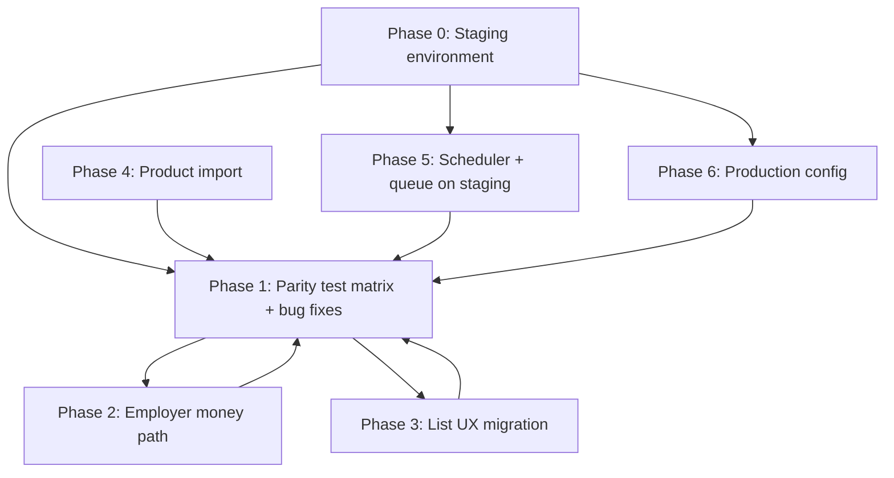

# V2 Implementation Plan — Critical & High Priority

> **Note:** This plan assumes **V1 staging parity** and cutover. If Nexa launches as a **new product** (no V1 DB/domain), use [nexa-product-audit-and-roadmap.md](../nexa-product-audit-and-roadmap.md) instead — especially the **v1.0 GA** and **90-day** sections.

**Source:** [technical-audit-v1-v2.md](../technical-audit-v1-v2.md) §9  
**Branch:** `v2/main`  
**Horizon:** ~4–6 weeks (can run workstreams in parallel after staging exists)  
**Roles:** **BE** = `apps/nexa-api` · **FE** = `apps/nexa-web` · **Ops** = infra/runbooks · **QA** = parity sign-off

This plan turns the audit’s **Critical** and **High priority** items into ordered work packages with dependencies, acceptance criteria, suggested PRs, and file touchpoints.

---

## Goals

| # | Goal | Success metric |
|---|------|----------------|
| C1 | Staging parity pass | All sign-off checkboxes in audit §9 green on staging + prod DB copy |
| C2 | Employer money path | Create → list → print → cancel verified; CMI sandbox on staging |
| C3 | Uniform list UX | Every nav list page uses DataTable + Dialog/Sheet + safe row actions |
| H4 | Product Excel import | Owner can import same spreadsheet format as V1 with row-level errors |
| H5 | Scheduler parity | Cron + queue worker running on staging; three `nexa:*` commands verified |
| H6 | Production config | Sanctum, CORS, URLs, CMI callback documented and applied on staging/prod |

---

## Dependency overview



**Critical path to cutover:** Phase 0 → Phase 1 (parity) → Phase 2 (money) + Phase 5 (scheduler) → Phase 6 (prod config).

Phase 3 (list UX) and Phase 4 (import) can run in parallel with Phase 2 once staging exists; both feed back into Phase 1 re-runs.

---

## Phase 0 — Staging foundation (Ops + BE, ~2–3 days)

**Blocks:** everything else.

| ID | Task | Owner | Output |
|----|------|-------|--------|
| P0-1 | Provision staging: API host, web host, MySQL 8, Redis | Ops | Staging URLs documented |
| P0-2 | Copy production DB to staging (anonymize PII if required) | Ops | Staging DB `nexa_staging` |
| P0-3 | Deploy `v2/main`: API migrate, web build, env files | Ops | Matches [deployment-v2.md](../runbooks/deployment-v2.md) |
| P0-4 | Seed only if empty; otherwise use prod copy as-is | BE | Demo logins or real owner accounts |
| P0-5 | CMI **sandbox** credentials on staging API `.env` | BE + Ops | `CMI_*` vars, callback URL reachable |
| P0-6 | Create parity tracker spreadsheet (or GitHub Project) from §1 test matrix | QA | One row per flow × role |

**Definition of done:** Staging login works for admin, owner, employer; `GET /api/v1/health` OK; web loads without build errors.

---

## Phase 1 — Staging parity pass (QA-led, ~1 week + fix loop)

**Audit item:** Critical #1 · Rebuild: **W7-3**

### 1.1 Test matrix (execute on staging)

Run each flow as the listed role. Mark **Pass / Fail / N/A**. Log failures as GitHub issues with `parity` label.

#### Authentication & navigation

| ID | Flow | Role | V1 reference | V2 route | Pass |
|----|------|------|--------------|----------|------|
| T-01 | Login + redirect to dashboard | admin | `auth.login` | `/login` → `/admin` | |
| T-02 | Login + redirect | owner | same | `/owner` | |
| T-03 | Login + redirect | employer | same | `/employer` | |
| T-04 | All sidebar nav links load (no 404) | each role | nav menus | `lib/nav-config.ts` hrefs | |
| T-05 | Logout | each | | clears session | |

#### Employer — money path (overlaps Phase 2)

| ID | Flow | V2 route / API |
|----|------|----------------|
| T-10 | POS catalog loads | `GET /pos/catalog` |
| T-11 | Create invoice (customer + lines + pay) | `/employer/invoices/create`, `POST /invoices` |
| T-12 | List invoices | `/employer/invoices` |
| T-13 | View invoice detail | `/employer/invoices/[id]` |
| T-14 | Print invoice | `/employer/invoices/[id]/print` |
| T-15 | Cancel invoice | row action → `POST /invoices/{id}/cancel` |

#### Owner — billing & ops

| ID | Flow | V2 route / API |
|----|------|----------------|
| T-20 | List / filter invoices | `/owner/invoices` |
| T-21 | Payment preview | `GET /payments/preview` |
| T-22 | CMI checkout redirect | `/owner/payments/checkout` |
| T-23 | CMI return page | `/owner/payments/return` |
| T-24 | Campaign create / edit / toggle | `/owner/campaigns` |
| T-25 | Cross-selling rules | `/owner/cross-selling` |
| T-26 | Calendar CRUD | `/owner/calendar` |
| T-27 | Reports + export | `/owner/reports` |

#### Admin — platform

| ID | Flow | V2 route / API |
|----|------|----------------|
| T-30 | Owners CRUD + activate | `/admin/owners` |
| T-31 | Activities CRUD | `/admin/activities` |
| T-32 | Stores list (read) | `/admin/stores` |
| T-33 | Customers / products directory | `/admin/customers`, `/admin/products` |
| T-34 | Payments list | `/admin/payments` |
| T-35 | Dashboard KPIs + charts | `/admin` + `GET /dashboard/kpis` |

#### Backend / scheduler (feeds Phase 5)

| ID | Flow | Command / check |
|----|------|-----------------|
| T-40 | Birthday billing rows | `php artisan nexa:birthday-campaign` |
| T-41 | Cross-selling SMS queued | `php artisan nexa:cross-selling` |
| T-42 | RDV reminders | `php artisan nexa:rendez-vous` |

### 1.2 Fix loop

| ID | Task | Owner |
|----|------|-------|
| P1-1 | Triage failures: **P0** = money/auth/data loss; **P1** = feature broken; **P2** = UX/copy | QA |
| P1-2 | Fix P0/P1 in stacked PRs to `v2/main` (one domain per PR) | BE + FE |
| P1-3 | Re-run failed matrix rows after each merge | QA |
| P1-4 | Update parity checklist in [v2-platform-rebuild.md](./v2-platform-rebuild.md) *V2 verified* column | QA |

**Definition of done:** Zero P0/P1 open; audit §9 sign-off boxes checked except import (H4) and optional WCAG (W6-4).

---

## Phase 2 — Employer money path hardening (BE + FE + QA, ~1 week)

**Audit item:** Critical #2 · Rebuild: **W1**, **W2**

Money path is partially built; this phase closes gaps found in Phase 1 and hardens for production.

### 2.1 Backend

| ID | Task | Files / area | Acceptance |
|----|------|--------------|------------|
| P2-B1 | Confirm invoice totals match V1 rules (HT/TTC, line math) | `InvoiceController`, services | API test vs V1 sample invoice |
| P2-B2 | Cancel policy: employer can only cancel own store, correct status | `InvoicePolicy`, tests | IDOR test passes |
| P2-B3 | Print endpoint returns same fields as V1 receipt | `InvoiceController::print`, `InvoiceResource` | Visual compare staging |
| P2-B4 | CMI callback idempotency on staging sandbox | `PaymentController`, `CmiHashVerifier` | Double callback = one payment |
| P2-B5 | Queue jobs for payment confirmation email/SMS | `SendPaymentConfirmation*Job` | Worker consumes on staging Redis |

### 2.2 Frontend

| ID | Task | Files | Acceptance |
|----|------|-------|------------|
| P2-F1 | Create flow: catalog errors, empty cart, validation messages | `employer/invoices/create/` | Playwright green |
| P2-F2 | List: cancel confirm dialog + refresh | `invoices-table.tsx`, `invoice-row-actions.tsx` | Manual + E2E |
| P2-F3 | Print page: logo, store footer, line items | `invoice-print-view.tsx` | Matches V1 PDF/screenshot |
| P2-F4 | Checkout/return error i18n (W1-4) | `owner/payments/*`, `lib/i18n` | FR/AR strings present |

### 2.3 QA / automation

| ID | Task | Acceptance |
|----|------|------------|
| P2-Q1 | Extend Playwright: invoice create → print → cancel | `e2e/employer-invoices.spec.ts` |
| P2-Q2 | Extend Playwright: owner checkout happy path (existing) on **staging** URL | `e2e/owner-checkout.spec.ts` |
| P2-Q3 | Manual CMI sandbox round-trip documented with screenshots | Attached to W7-3 sign-off |

**Suggested PRs:**

- `v2/fix/invoice-parity` (BE tests + print fields)
- `v2/fix/employer-invoice-ux` (FE errors + cancel)
- `v2/test/e2e-staging-money-path` (CI optional staging job)

---

## Phase 3 — Uniform list UX (FE, ~1.5–2 weeks)

**Audit item:** Critical #3 · Pattern: [.cursor/rules/nexa-web-ui.mdc](../../.cursor/rules/nexa-web-ui.mdc)

### Reference implementation (already done)

- `admin/owners`, `admin/activities`
- `employer/customers`, `employer/products`
- `owner/stores`, `owner/campaigns` (details table), `owner/cross-selling` (rules table)
- `employer/invoices` (DataTable via `invoices-table.tsx`)
- `components/calendar/appointments-panel.tsx`

### Per-page migration checklist

For each page below:

1. Add `*-columns.tsx` with hidden `search` column + `filterPlaceholder`
2. Add `*-row-actions.tsx` using `DataTableRowActionsMenu` (never inline `DropdownMenu` in columns)
3. Move create to `PageHeader` → Dialog (or keep dedicated route for heavy flows)
4. Remove inline Card forms above the table
5. Add i18n: `filterPlaceholder`, `openMenu`
6. Smoke test row actions (no “page couldn’t load” crash)

| Priority | Page | Branch suggestion | Create pattern | Notes |
|----------|------|-------------------|----------------|-------|
| P0 | `admin/stores` | `v2/feat/ui-admin-stores` | Read-only list or Dialog edit if added | Mirror `owner/stores` |
| P0 | `owner/invoices` | `v2/feat/ui-owner-invoices` | N/A (list only) | Cancel/view/print actions |
| P0 | `owner/customers` | `v2/feat/ui-owner-customers` | Dialog | Reuse `customer-form-dialog` |
| P1 | `admin/customers` | `v2/feat/ui-admin-customers` | Read-only | Admin directory |
| P1 | `admin/products` | `v2/feat/ui-admin-products` | Read-only | |
| P1 | `admin/payments` | `v2/feat/ui-admin-payments` | Read-only | |
| P1 | `owner/products` | `v2/feat/ui-owner-products` | Dialog | Reuse product/category dialogs |
| P1 | `owner/payments` | `v2/feat/ui-owner-payments` | Link to checkout | |
| P2 | `admin/campaigns` | `v2/feat/ui-admin-campaigns` | Read-only details | |
| P2 | `admin/cross-selling` | `v2/feat/ui-admin-cross-selling` | Read-only | |
| P2 | `admin/calendar` | `v2/feat/ui-admin-calendar` | Shared `AppointmentsPanel` | Store filter |
| P2 | `employer/calendar` | `v2/feat/ui-employer-calendar` | Shared panel | |
| P2 | `owner/calendar` | `v2/feat/ui-owner-calendar` | Shared panel | |
| P3 | History tables on campaigns/cross-selling | `v2/feat/ui-campaign-history` | N/A | Optional DataTable for SMS history |

**Definition of done:** Grep shows no raw `DropdownMenu` inside `*-columns.tsx`; all list pages use `DataTable`; lint passes.

---

## Phase 4 — Product Excel import (BE + FE + QA, ~1 week)

**Audit item:** High #4 · Rebuild: **W5-1 → W5-3**

### 4.1 V1 behaviour to match

Source: `legacy/v1/app/Imports/ProductsImport.php`

- Upload Excel per **store**
- **6 columns:** group by category (col 5), create categories + products
- **4 columns:** flat product list (label, price, promo, qty)
- Skip header row; ignore empty rows

### 4.2 Backend (W5-1)

| ID | Task | Detail |
|----|------|--------|
| P4-B1 | Add `maatwebsite/excel` (or `phpoffice/phpspreadsheet`) to `nexa-api` | Pin version in `composer.json` |
| P4-B2 | `ProductImportService` — port logic from V1, no `new CategorieService()` in import | Use existing `Category` / `Product` models |
| P4-B3 | `POST /api/v1/products/import` — multipart `file` + `store_id` | Form Request validation (mime, size max) |
| P4-B4 | Response shape: `{ created: N, categories: N, errors: [{ row, message }] }` | Partial success allowed |
| P4-B5 | Policy: owner/admin for store; employer for own store | `ProductPolicy` / `StoreAccess` |
| P4-B6 | Feature test with fixture `.xlsx` (4-col and 6-col) | `tests/Feature/Products/ProductImportTest.php` |

### 4.3 Frontend (W5-2)

| ID | Task | Detail |
|----|------|--------|
| P4-F1 | `ProductImportDialog` on `owner/products` PageHeader | File input + store selector if multi-store |
| P4-F2 | Show progress + result summary (created / errors table) | |
| P4-F3 | i18n EN/FR/AR for import strings | |
| P4-F4 | Optional: same dialog on `admin/products` with store picker | |

### 4.4 QA (W5-3)

| ID | Task | Acceptance |
|----|------|------------|
| P4-Q1 | Same spreadsheet imported on V1 staging vs V2 staging | Row counts match |
| P4-Q2 | Invalid row (bad price) returns error without failing whole file | |

**Suggested PRs:** `v2/feat/product-import-api` → `v2/feat/product-import-ui`

---

## Phase 5 — Scheduler & queue parity on staging (Ops + BE, ~2–3 days)

**Audit item:** High #5 · Rebuild: **W3-5** (documented; needs **live staging** proof)

Commands already registered in `apps/nexa-api/routes/console.php`:

| Command | Schedule | V1 equivalent |
|---------|----------|---------------|
| `nexa:birthday-campaign` | Daily 12:00 Africa/Casablanca | `birthday:campaign` |
| `nexa:cross-selling` | Daily 09:00 | cross-selling command |
| `nexa:rendez-vous` | Hourly | RDV reminders |

### Tasks

| ID | Task | Owner | Verification |
|----|------|-------|--------------|
| P5-1 | Cron: `* * * * * php artisan schedule:run` on API host | Ops | `schedule:list` shows 3 tasks |
| P5-2 | `QUEUE_CONNECTION=redis` on staging + Supervisor worker | Ops | `queue:work` running |
| P5-3 | Run each command manually; compare DB rows to V1 on same data slice | BE + QA | T-40–T-42 pass |
| P5-4 | Document staging worker in [deployment-v2.md](../runbooks/deployment-v2.md) § Docker sidecar if needed | Ops | |
| P5-5 | Alert/monitor: queue depth + failed_jobs | Ops | Optional for H6 |

**Definition of done:** After 24h on staging, expected SMS/billing rows appear; no stuck jobs in `failed_jobs`.

---

## Phase 6 — Production config (BE + Ops, ~2–3 days)

**Audit item:** High #6 · Rebuild: **W7-4**

| ID | Variable / topic | Staging example | Production |
|----|------------------|-----------------|------------|
| P6-1 | `APP_URL` | `https://api-staging.nexa.app` | `https://api.nexa.app` |
| P6-2 | `FRONTEND_URL` | `https://staging.nexa.app` | `https://app.nexa.app` |
| P6-3 | `SANCTUM_STATEFUL_DOMAINS` | staging web host | prod web host |
| P6-4 | `SESSION_DOMAIN` | `.nexa.app` (if subdomains) | same pattern |
| P6-5 | CORS `config/cors.php` | allows staging web origin | allows prod web origin |
| P6-6 | `NEXT_PUBLIC_API_URL` (web build) | public API URL | public API URL |
| P6-7 | CMI callback URL | `https://api-staging.../api/v1/payments/cmi/callback` | prod URL registered with CMI |
| P6-8 | `CMI_*` merchant keys | sandbox | production keys |
| P6-9 | TLS certificates + HSTS | | Ops checklist |

### Validation script (manual)

1. Login from production web origin — cookie set, `GET /auth/me` works
2. Cross-origin preflight on API from web — no CORS error
3. CMI checkout from prod web — callback hits prod API
4. Logout clears cookie

**Deliverable:** Update [deployment-v2.md](../runbooks/deployment-v2.md) with staging vs production env table (appendix).

---

## Suggested timeline (single team)

| Week | Focus | Exit criteria |
|------|-------|---------------|
| **1** | Phase 0 + start Phase 1 matrix | Staging up; ≥50% flows tested |
| **2** | Phase 1 fix loop + Phase 2 money path | T-10–T-15 green; CMI sandbox once |
| **3** | Phase 3 list UX (P0 pages) + Phase 5 scheduler on staging | Admin stores, owner invoices/customers migrated |
| **4** | Phase 3 (P1 pages) + Phase 4 import API | Import endpoint + tests |
| **5** | Phase 4 import UI + Phase 6 prod config on staging | W5-3 pass; env checklist complete |
| **6** | Phase 1 full re-run + buffer | Ready for W8 cutover decision |

---

## PR stack order (recommended merges to `v2/main`)

```
1. v2/ops/staging-env-docs          (Phase 0 — docs only, no secrets)
2. v2/fix/*                         (Phase 1 parity fixes, as discovered)
3. v2/fix/employer-invoice-ux       (Phase 2)
4. v2/feat/ui-admin-stores          (Phase 3)
5. v2/feat/ui-owner-invoices
6. v2/feat/ui-owner-customers
7. … remaining ui-* branches
8. v2/feat/product-import-api       (Phase 4)
9. v2/feat/product-import-ui
10. v2/ops/deployment-env-appendix  (Phase 6)
```

Keep PRs **≤400 lines** where possible; one page or one API domain per PR.

---

## Risk register

| Risk | Mitigation |
|------|------------|
| Prod DB copy contains PII | Anonymize phones/emails on staging copy |
| CMI sandbox differs from prod | Separate P6 checklist; one prod test transaction before cutover |
| List UX regressions | Mandatory row-action click test per page |
| Import duplicates products | Add `duplicate_label` strategy (skip or update) — document in API |
| Queue not running in prod | P5-2 blocker for go-live; monitor `failed_jobs` |

---

## Sign-off (copy to release ticket)

- [ ] Phase 0: Staging environment live
- [ ] Phase 1: Parity matrix ≥95% pass (document exceptions)
- [ ] Phase 2: Employer money path E2E on staging
- [ ] Phase 3: All P0/P1 list pages on DataTable pattern
- [ ] Phase 4: Product import W5-3 pass
- [ ] Phase 5: Scheduler + worker verified 24h on staging
- [ ] Phase 6: Production env checklist applied to staging, then prod

---

## References

- [technical-audit-v1-v2.md](../technical-audit-v1-v2.md)
- [v2-platform-rebuild.md](./v2-platform-rebuild.md) — Waves W5–W7
- [deployment-v2.md](../runbooks/deployment-v2.md)
- UI pattern rule: [.cursor/rules/nexa-web-ui.mdc](../../.cursor/rules/nexa-web-ui.mdc)

*Last updated: June 9, 2026*
