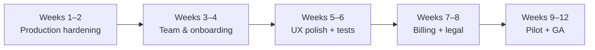

# Nexa Product Audit & Roadmap

**Product:** Nexa — multi-store retail operations platform (POS, CRM, campaigns, payments, analytics)  
**Codebase:** `apps/nexa-api/` + `apps/nexa-web/`  
**Audit date:** June 9, 2026  
**Audience:** Product + engineering — planning **first production launch** and **V3 platform evolution**

---

## How to read this document

This audit is **not** a V1 migration checklist. You are launching Nexa as a **new product** on new infrastructure, domain, and database. Legacy V1 (`legacy/v1/`) is a **domain reference**: workflows you validated with a client, not a contract you must copy.

| Lens | Old framing (discard) | New framing (use this) |
|------|----------------------|-------------------------|
| Success | “Match V1 on staging with prod DB copy” | “Ship a sellable SaaS customers pay for on day one” |
| Features | Port every V1 module | Keep proven workflows; drop or redesign weak ones |
| Billing | CMI usage invoices only | Subscription + usage, globally extensible |
| Architecture | Shared schema with V1 | Clean Nexa schema owned by V2 |

**Related docs (historical):** [technical-audit-v1-v2.md](./technical-audit-v1-v2.md) (parity comparison), [v2-platform-rebuild.md](./improvement/v2-platform-rebuild.md) (build log).

> **Implementation plan (PR-driven):** [nexa-v1-ga-implementation-plan.md](./improvement/nexa-v1-ga-implementation-plan.md)

---

## Executive summary

Nexa V2 is a **strong technical foundation** for a vertical SaaS in retail / multi-location SMB — modern stack, API-first, real business logic (POS, campaigns, cross-selling, calendar, reports), and a polished UI shell with trilingual support. It is **not yet** an international self-serve SaaS product. Today it behaves like a **well-built operations console** for businesses you onboard manually (admin creates owners), with **Morocco-centric** payment and SMS integrations and **no subscription layer**.

| Dimension | Score (1–5) | One-line verdict |
|-----------|-------------|------------------|
| **Architecture** | 4 | Laravel 12 + Next.js 16 API-first — right long-term shape |
| **Domain depth** | 4 | Core retail loop (catalog → invoice → print → CRM → campaigns) is real |
| **UX / design system** | 3.5 | shadcn + DataTable patterns emerging; uneven across roles |
| **SaaS readiness** | 2 | No signup, plans, billing portal, legal, onboarding |
| **Internationalization** | 2.5 | en/fr/ar UI strings; MAD/Casablanca/CMI/BulkSMS defaults |
| **Security & compliance** | 3 | Policies + IDOR tests; thin rate limits, no audit trail |
| **Production hardening** | 2.5 | Dev Dockerfile, missing E2E in `nexa-web`, client-only auth guard |
| **Monetization fit** | 2 | Usage billing to platform owner, not recurring SaaS revenue |

**Strategic recommendation:** Treat the next milestone as **Nexa v1.0 GA** — a focused **B2B product you sell and onboard** (sales-led or invite-only), not full self-serve global SaaS. Plan **V3** as the platform upgrade: organizations, Stripe subscriptions, self-serve, integrations, mobile.

---

## What Nexa is today (product definition)

```
┌─────────────────────────────────────────────────────────────────┐
│  Platform Admin          │  Owns the Nexa installation        │
│  (you / your team)       │  Creates owner accounts, pricing     │
└────────────┬────────────┴──────────────────────────────────────┘
             │
┌────────────▼────────────┐     ┌──────────────────────────────┐
│  Owner (business)       │     │  Multiple stores per owner   │
│  Pays platform usage    │────▶│  Campaigns, reports, billing │
│  (SMS/email via CMI)    │     │  Store settings              │
└────────────┬────────────┘     └──────────────────────────────┘
             │
┌────────────▼────────────┐
│  Employer (staff)       │  One store — POS, customers, calendar
└─────────────────────────┘
```

**Validated value proposition (from V1 thinking, still valid):**
- Run day-to-day retail: sell, receipt, customer file, catalog
- Market to customers: SMS campaigns, birthday automation, cross-selling rules
- Operate multiple locations under one business owner
- See sales/customer/product reports without spreadsheets

**What is missing for “I can put this on Product Hunt and sell globally”:**
- Self-serve signup, trials, plan selection
- Recurring subscription (Stripe/Paddle)
- Owner team management (invite employers without admin)
- Legal/compliance surface (privacy, terms, DPA)
- Provider abstraction beyond Morocco (SMS, payments, tax)

---

## V2 strengths

### 1. Architecture you can grow on

| Strength | Evidence |
|----------|----------|
| API-first | REST `/api/v1/*`, 20 controllers, 18 API Resources, 22 Form Requests |
| Modern stack | Laravel 12, PHP 8.2+, Next.js 16, React 19, Tailwind 4 |
| Authorization model | `StoreAccess` + 14 Policies + dedicated IDOR tests |
| Service layer | Invoices, payments, campaigns, dashboard, reports extracted from controllers |
| Integration contracts | `PaymentGateway`, `SmsGateway` — swappable implementations |
| CI discipline | Pint, PHPUnit (~29 feature tests), Playwright job in `v2-ci.yml` |
| Docker dev stack | MySQL + API + web in `docker-compose.yml` |
| ADR culture | [002-nextjs-api-first-ui](./adr/002-nextjs-api-first-ui.md) |

### 2. Real business features (not a CRUD demo)

| Domain | API | Web | Notes |
|--------|-----|-----|-------|
| POS / invoices | ✅ | ✅ | Catalog, create, print, cancel |
| Customers & products | ✅ | ✅ | Categories, employer CRUD |
| Campaigns | ✅ | ✅ | Filters, history, scheduled birthday billing rows |
| Cross-selling | ✅ | ✅ | Rules + SMS history |
| Calendar / RDV | ✅ | ✅ | Shared `AppointmentsPanel`, hourly reminders |
| Reports | ✅ | ✅ | Sales, customers, products + export |
| Owner platform billing | ✅ | ✅ | CMI checkout for consumed SMS/email |
| Admin platform ops | ✅ | ✅ | Owners, activities, directory views |
| Dashboard analytics | ✅ | ✅ | KPI cards + 7-day Recharts trends |

### 3. UX and brand

- Cohesive **Nexa** brand (`lib/brand.ts`, logo, CSS tokens)
- Documented UI pattern: DataTable + Dialog + safe row actions (`.cursor/rules/nexa-web-ui.mdc`)
- **Trilingual UI** (en / fr / ar) with RTL `dir` for Arabic
- Guest marketing site: home, pricing, compare, docs, changelog, testimonials, privacy, terms (`components/marketing/`, routes under `/`, `/pricing`, `/compare`, `/docs`, `/changelog`, `/privacy`, `/terms`)
- Role-based workspaces with clear navigation (`lib/nav-config.ts`)

### 4. Testability

- Feature tests across auth, stores, invoices, payments, campaigns, scheduler, API resource contracts
- Integration unit tests for CMI hash and BulkSMS gateway
- Queue job tests with `sync` driver

---

## V2 weaknesses

Weaknesses are grouped by **business impact**, not code style.

### A. Product & go-to-market gaps (highest impact)

| Weakness | Why it hurts resale |
|----------|---------------------|
| **No self-serve signup** | Every customer requires you to manually create an owner in admin |
| **No subscription / plans** | You cannot charge €49/mo per store; only usage settlement via CMI |
| **No trial or onboarding wizard** | New owners get a store wizard but no product tour, checklist, or sample data choice |
| **Marketing site still pre-GA** | Pages exist (pricing, compare, docs, changelog, testimonials, privacy, terms) but pricing is sales-led placeholder, legal copy needs counsel review, no separate docs site or status page |
| **No cookie / analytics policy** | Privacy + terms stubs published; cookie notice still required if analytics added |
| **Admin-centric control** | 🟡 Owner team invite in progress (`/owner/team`, PR-06) — admin employer directory still optional |
| **Morocco-default positioning** | MAD currency, CMI, BulkSMS.ma, `Africa/Casablanca` scheduler — fine for MA launch, not “international” |

### B. UX inconsistencies

| Weakness | Detail |
|----------|--------|
| **Uneven CRUD by role** | Employer has full customer/product CRUD; owner/admin often read-only tables on same entities |
| **List UX not uniform** | DataTable pattern on ~8 pages; others still basic `Table` |
| **No settings for owner/employer** | Only admin settings (locale/theme); profile/password disabled in sidebar |
| **Login pre-filled dev credentials** | `employer@nexa.test` in `login-form.tsx` — must not ship to prod |
| **Marketing hero uses illustrative UI** | Dashboard preview is styled mock, not product screenshots or live demo |

### C. Technical / production gaps

| Weakness | Detail |
|----------|--------|
| **Client-only auth** | No Next.js `middleware.ts`; `useRequireAuth` in `useEffect` — flash before redirect |
| **No data fetching layer** | No React Query/SWR; refetch duplication, stale lists |
| **Almost all `"use client"`** | Misses RSC benefits for dashboards, SEO, performance |
| **Dockerfile runs dev server** | `CMD npm run dev:docker` — not production `next start` multi-stage build |
| **E2E tests missing in `nexa-web`** | Specs still under old `apps/sherin-web/e2e/` path; CI may run empty suite |
| **No `error.tsx` / `loading.tsx`** | Poor failure UX on network errors |
| **Queue worker not in Compose** | SMS jobs need manual `queue:work` in dev |
| **API rate limiting** | Only login throttled (`6/min`); no per-tenant API limits |

### D. Data model & domain debt

| Weakness | Detail |
|----------|--------|
| **Legacy column names** | French fields, `historique_paiements`, `is_admin` integer roles |
| **Flat owner → stores** | No organization/workspace; hard to add agencies, franchises, RBAC |
| **Store feature flags in DB columns** | `allow_camp`, `Anniv`, etc. — no entitlement system |
| **Platform billing ≠ SaaS billing** | Owners pay you for SMS usage; not the same as their subscription to Nexa |
| **V1 modules undecided** | Employees, restaurant tables, caisse, Excel import — carry complexity without product decision |

### E. Security & compliance (medium term)

| Gap | Status |
|-----|--------|
| Audit log (who changed what) | ❌ |
| GDPR export / deletion | ❌ |
| Password reset / MFA | ❌ |
| API tokens for integrations | Sanctum PAT migration exists; no issuance UI |
| SSO (Google, Microsoft) | ❌ |
| Webhooks for partners | ❌ inbound CMI only |
| Observability (Sentry, metrics) | ❌ |

### F. Accessibility

- Limited ARIA usage; no skip links or systematic a11y testing
- Root `layout.tsx` hardcodes `lang="en"` until client hydration
- shadcn `components.json` has `"rtl": false` while app supports Arabic RTL

---

## V1 features: keep, drop, or reinvent

Use this when prioritizing. **Default to reinvent** if V1 UX was clunky.

| V1 concept | Recommendation | V2 status | Notes |
|------------|----------------|-----------|-------|
| POS invoice flow | **Keep** (refine) | Built | Core revenue feature for your buyers’ staff |
| Customer CRM | **Keep** | Built | Add tags/segments in V3 |
| Product catalog + categories | **Keep** | Built | Excel import → optional v1.0 if buyers ask |
| SMS campaigns + filters | **Keep** (simplify admin ops) | Built | Drop V1 bulk `reset`/`payAll` unless ops need them |
| Birthday automation | **Keep** | Built | |
| Cross-selling rules | **Keep** | Built | |
| Calendar / RDV | **Keep** | Built | |
| Reports + export | **Keep** | Built | PDF export nice-to-have v1.0 |
| Multi-store per owner | **Keep** | Built | |
| CMI platform billing | **Keep for MA** | Built | Add Stripe for SaaS fee in V3 |
| Owner store wizard | **Keep** | Built | Extend into onboarding |
| Employees (employer users) | **Reinvent** | 🟡 PR-06 | Owner-invited staff at `/owner/team`; fine-grained permissions → V3 |
| Restaurant table management | **Drop or V3+** | Missing | Only if you target F&B vertical |
| Caisse / fonds de caisse | **Reinvent** | Missing | Modern “cash drawer sessions” if retailers need it |
| Email templates / newsletter | **Reinvent** | Missing | Use a proper campaign composer in V3 |
| Admin manual SMS | **Drop** | Missing | Replace with support tools + audit |
| Guest marketing site (V1) | **Reinvent** | 🟡 Partial | Home + pricing + compare + docs hub + changelog + testimonials + legal stubs in `nexa-web` |
| Epingles (pins) full CRUD | **Drop or low** | Read-only API | Unless calendar UX requires it |
| Objectives / gamification | **Drop** | Missing | Unless validated with clients |

---

## Nexa v1.0 GA — what “release” should look like

**v1.0 is not V3.** It is the first version **you can sell, deploy for paying customers, and support** without embarrassing gaps.

### Positioning statement (suggested)

> **Nexa** helps multi-location retailers run POS, customer relationships, and SMS marketing from one platform — with per-store staff access and owner-level analytics.

**Initial market:** Morocco and French-speaking SMB retail (play to your integrations), with UI ready for expansion.

### v1.0 must-have (release blockers)

#### Product

- [ ] **Remove all dev defaults** — empty login form, no demo passwords in prod builds
- [x] **Owner can invite employers** — API + UI (`/owner/team`; merge PR-06 to `v2/main`)
- [ ] **Owner settings** — profile, password change, store defaults (currency display, timezone)
- [ ] **Uniform list UX** on all primary list pages (DataTable + row actions)
- [ ] **Production Docker** — multi-stage `next build` + `next start`; API `php-fpm` or `octane` image
- [x] **Legal minimum (stub)** — `/privacy`, `/terms` (static i18n pages — **counsel review before prod**)
- [x] **Pricing page (stub)** — `/pricing` with Starter / Growth / Enterprise tiers and “Talk to sales” CTAs (**wire to Stripe or CRM before GA**)
- [ ] **Onboarding checklist** — owner dashboard: create store → add products → invite staff → send first campaign

#### Billing (your revenue)

Pick **one** model for v1.0:

| Model | Fit | Implementation |
|-------|-----|----------------|
| **A. Sales-led + manual invoicing** | Fastest | You bill off-platform; Nexa tracks plan in admin flag |
| **B. Subscription + Stripe** | Better SaaS story | Laravel Cashier; owner billing portal — **recommended before “international” claim** |
| **C. Usage-only (current CMI)** | Matches V1 | Keep for SMS pass-through; add **platform fee** line item |

**Recommendation:** **B or A+B** — Stripe (or Paddle) for Nexa subscription; keep CMI/BulkSMS for pass-through usage in Morocco.

#### Operations

- [ ] **Production runbook** — env vars, cron, Redis queue worker, backups, `FRONTEND_URL`, Sanctum domains
- [ ] **Migrate E2E tests** to `apps/nexa-web/e2e/` and enforce in CI
- [ ] **Error monitoring** — Sentry on API + web
- [ ] **Email delivery** — real SMTP/Resend/Postmark (not `MAIL_MAILER=log`)
- [ ] **Database backups** — automated daily

#### Security

- [ ] **Password reset** flow
- [ ] **Next.js middleware** auth gate for `(admin|owner|employer)` routes
- [ ] **Global API rate limit** (e.g. 60/min per user)
- [ ] **Security headers** on web (CSP baseline)

### v1.0 should-have (ship within 30 days after GA)

- [ ] Product import (Excel/CSV) for catalog onboarding
- [ ] Invoice PDF download (not only print view)
- [ ] Admin impersonation / support login (audited)
- [ ] React Query for list pages (cache + optimistic updates)
- [ ] Playwright: login, invoice create, owner checkout
- [ ] WCAG pass on login, POS, and checkout (keyboard + screen reader basics)

### v1.0 explicitly out of scope

- Self-serve signup without sales review
- Mobile native app
- Restaurant table management
- Multi-country tax engine
- SSO / enterprise contracts
- White-label / reseller portal
- AI features

### v1.0 definition of done (sign-off)

| Gate | Criteria |
|------|----------|
| **Commercial** | 1 pilot customer live on prod URL; they pay your subscription (or signed contract) |
| **Functional** | Employer completes 10 invoices; owner runs 1 campaign; payment flow succeeds in prod |
| **Reliability** | 7 days uptime; queue worker monitored; backups verified |
| **Support** | You can reset password, deactivate user, and see logs for failed SMS/payment |
| **Legal** | Privacy + terms published; cookie notice if you add analytics |

---

## Pre-GA improvement roadmap (recommended order)

Replaces the old “staging parity with V1” plan. **~8–12 weeks** for a small team.



| Phase | Focus | Key deliverables |
|-------|-------|------------------|
| **1. Hardening** | Ship safely | Prod Dockerfile, middleware auth, remove dev leaks, Sentry, E2E in `nexa-web` |
| **2. Team model** | Customers scale | Owner invites employers (PR-06 ✅ local); profile/settings (PR-07–08) |
| **3. UX completeness** | Professional feel | DataTable everywhere, owner settings, onboarding checklist, real marketing screenshots |
| **4. Monetization** | You make money | Stripe subscription (or documented sales-led plan), pricing page |
| **5. Pilot** | Proof | 1–3 paying pilots, feedback loop, fix P0 bugs |
| **6. GA** | Launch | Legal pages, runbook, announce |

---

## Nexa V3 — what the platform should become

V3 is the **international, self-serve, extensible SaaS platform** — the product that can scale beyond your first market and vertical.

### V3 product vision

> **Nexa** is the operating system for local retail chains: sell in-store, know your customers, automate marketing, and integrate with the tools you already use — globally, on a subscription you control.

### V3 pillars

#### 1. Platform & tenancy

| Capability | V2 | V3 target |
|------------|-----|-----------|
| Tenant model | `store_id` scoping | **Organization** → stores → users |
| Signup | Admin-created | **Self-serve** + email verify + trial |
| Plans | None | **Starter / Growth / Enterprise** entitlements |
| Feature flags | DB columns on `stores` | **Plan entitlements** service |
| Data residency | Single region | EU/US region selector (enterprise) |

#### 2. Billing & revenue

- **Stripe Billing** (subscriptions, metered SMS, invoicing, customer portal)
- Multiple payment providers per region (CMI MA, Stripe EU/US, optional local PSPs)
- Usage dashboards for owners (“SMS spend this month”)
- Your **admin revenue dashboard** — MRR, churn, ARPU

#### 3. Integrations & ecosystem

- **Outbound webhooks** — `invoice.created`, `customer.created`, `campaign.sent`
- **Public REST API** + API keys + OpenAPI docs
- **Zapier / Make** connectors (or official integration marketplace)
- SMS/email provider plugins (Twilio, MessageBird, SendGrid, Resend)
- Accounting export (QuickBooks, Xero) — V3+

#### 4. Mobile & offline

- React Native or Flutter app on **same API** (Sanctum PAT)
- Employer POS optimized for tablet
- Optional offline queue for invoice create (sync when online)

#### 5. Intelligence & automation (differentiation)

- Customer segments (RFM, last visit, birthday)
- Campaign A/B and send-time optimization
- Low-stock alerts
- AI-assisted campaign copy (opt-in, locale-aware) — only after core platform is stable

#### 6. Compliance & enterprise

- GDPR: export, delete, DPA template
- Audit log (admin actions, billing changes)
- SSO (OIDC/SAML) on Enterprise plan
- SOC 2 path (logging, access reviews, encryption at rest)
- Role-based permissions beyond 3 fixed roles

#### 7. UX & international

- Locale in URL (`/fr/owner/...`) or subdomain
- Per-store timezone and currency
- Tax/VAT rules engine (configurable, not hardcoded `NEXA_TVA`)
- Full RTL + accessibility WCAG 2.2 AA on critical flows
- In-app help, docs site, status page

### V3 architecture sketch

```
                    ┌─────────────────────────────────────┐
                    │  Marketing + Docs + Status (Next.js) │
                    └──────────────────┬──────────────────┘
                                       │
     ┌─────────────────────────────────┼─────────────────────────────────┐
     │                         API Gateway / Edge                         │
     │              rate limits · auth · tenant resolution                  │
     └─────────────────────────────────┬─────────────────────────────────┘
                                       │
              ┌────────────────────────┼────────────────────────┐
              │                        │                        │
     ┌────────▼────────┐    ┌─────────▼─────────┐   ┌────────▼────────┐
     │  nexa-api       │    │  Worker service    │   │  Webhook dispatcher│
     │  (Laravel)      │    │  queues + scheduler│   │  (async outbound)  │
     └────────┬────────┘    └─────────┬─────────┘   └───────────────────┘
              │                        │
     ┌────────▼────────────────────────▼─────────┐
     │  MySQL (orgs, stores, billing, domain)     │
     │  Redis (cache, queues, rate limits)        │
     └────────────────────────────────────────────┘

     Integrations: Stripe · Twilio · CMI · email · storage (S3)
     Clients: nexa-web · mobile app · partner API consumers
```

### V3 milestone map (indicative)

| Milestone | Theme | Duration | Outcome |
|-----------|-------|----------|---------|
| **V3.0** | SaaS core | 3–4 months post v1.0 | Orgs, Stripe plans, self-serve signup, API keys |
| **V3.1** | Integrations | 2 months | Webhooks, Twilio/SendGrid, OpenAPI |
| **V3.2** | Mobile POS | 3–4 months | Employer app, PAT auth |
| **V3.3** | Enterprise | ongoing | SSO, audit, GDPR tooling, SLAs |

---

## Business model recommendations

### Today (V2)

- You charge owners for **consumed platform services** (SMS, email) via CMI — configured in `config/nexa.php` (`sms_price`, `email_price`, etc.)
- **You** are the platform operator; owners are your B2B customers

### v1.0 (recommended)

| Stream | Example |
|--------|---------|
| **Platform subscription** | 299 MAD / store / month (or €29) — includes N users, reports, POS |
| **Usage overage** | SMS/email at pass-through + margin |
| **Onboarding fee** | Optional setup for catalog import |

### V3 (target)

| Tier | Audience | Includes |
|------|----------|----------|
| **Starter** | 1 store, 2 staff | POS, CRM, basic reports |
| **Growth** | Up to 5 stores | Campaigns, cross-selling, API read |
| **Enterprise** | Unlimited + SSO | Webhooks, SLA, dedicated support |

---

## Risk register (product lens)

| Risk | If ignored | Mitigation |
|------|------------|------------|
| Shipping with dev login defaults | Credential leak / unprofessional | CI grep + prod build check |
| No subscription billing | You cannot scale revenue | Stripe before marketing “SaaS” |
| Morocco-only integrations | “International” claim fails | Market as MA/FR first; roadmap Stripe/Twilio |
| Copying all V1 features | Bloated product, slow GA | Use keep/drop table above |
| No employer invite flow | Every hire needs you | P0 for v1.0 |
| E2E gap in `nexa-web` | Regressions in POS | Move specs from `sherin-web` |
| Client-only auth | Brief unauthorized UI flash | Middleware + server session check |

---

## 90-day action plan (concrete)

| Week | Engineering | Product / business |
|------|-------------|-------------------|
| 1–2 | Prod Docker, middleware, remove login defaults, fix E2E path | Write pricing hypothesis; pick pilot customer |
| 3–4 | Owner invite employers API + UI | Privacy + terms draft |
| 5–6 | DataTable migration remaining pages; owner settings | Onboarding checklist UX |
| 7–8 | Stripe subscription OR admin “plan” flag + manual billing | Pricing page + sales deck |
| 9–10 | Sentry, email provider, queue in prod compose | Pilot onboarding |
| 11–12 | Bug burn-down, Playwright expansion | GA announcement, support playbook |

---

## Appendix — codebase quick reference

| Area | Path |
|------|------|
| API routes | `apps/nexa-api/routes/api.php` |
| Store authorization | `apps/nexa-api/app/Support/Authorization/StoreAccess.php` |
| Pricing config | `apps/nexa-api/config/nexa.php` |
| Integrations | `apps/nexa-api/config/integrations.php` |
| Web navigation | `apps/nexa-web/lib/nav-config.ts` |
| i18n | `apps/nexa-web/lib/i18n/messages/` |
| UI conventions | `.cursor/rules/nexa-web-ui.mdc` |
| CI | `.github/workflows/v2-ci.yml` |
| E2E (needs move) | `apps/sherin-web/e2e/*.spec.ts` → `apps/nexa-web/e2e/` |

---

## Document maintenance

| Version | Meaning |
|---------|---------|
| **V2 (current)** | Active build in `apps/nexa-*` |
| **v1.0 GA** | First commercial release on new prod |
| **V3** | Platform SaaS evolution (orgs, Stripe, self-serve, API) |

Update this doc when you lock billing model, first pilot, or V3.0 scope.

*Last updated: June 9, 2026 (marketing site expansion)*
